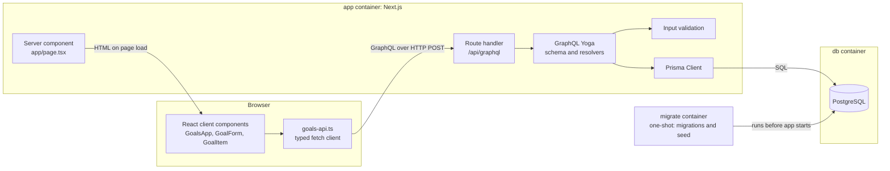

# Learning Goals

A small single-page web app for tracking what you want to learn. You can add a goal (a title and a target skill), mark it as done or not done, and delete it. The page lists your goals and shows how many are done. There is no login.

New to React or Next.js? [WALKTHROUGH.md](WALKTHROUGH.md) explains the code for someone coming from C# and Flutter.

**Stack:** Next.js 16 (App Router), React 19, TypeScript (strict), GraphQL Yoga, Prisma 7, PostgreSQL 17, Vitest, Docker Compose and GitHub Actions.

## Run it

You only need Docker. From this folder:

```bash
docker compose up
```

Then open <http://localhost:3000>. The first run takes a few minutes to build the images.

Compose starts three services in order:

1. `db` runs Postgres and waits until it is healthy.
2. `migrate` applies the migrations, seeds an empty database, then exits.
3. `app` serves the production Next.js build on port 3000.

| Task | Command |
| --- | --- |
| Use a different app port (if 3000 is taken) | `APP_PORT=3100 docker compose up` |
| Use a different Postgres port (if 5432 is taken) | `POSTGRES_PORT=5433 docker compose up` |
| Rebuild after changing code | `docker compose up --build` |
| Stop and keep the data | `docker compose down` |
| Stop and erase the data | `docker compose down -v` |

The Compose file has development-only default credentials, so no `.env` file is needed. To change them, copy `.env.example` to `.env`. Git ignores `.env`.

### Run it without Docker for the app

For hot reload while developing, run Postgres in Docker and the app on your machine. This needs Node 24 (see `.nvmrc`).

```bash
docker compose up -d db
cp .env.example .env
npm install
npx prisma migrate deploy
npx prisma db seed
npm run dev
```

The GraphiQL IDE is available at <http://localhost:3000/api/graphql> in development only.

| Script | What it does |
| --- | --- |
| `npm run lint` | ESLint with the Next.js rules |
| `npm run typecheck` | Generates Next.js route types, then runs `tsc` |
| `npm test` | Vitest unit tests |
| `npm run build` | Production build |

## Architecture



### GraphQL API

Everything the UI shows or changes goes through `POST /api/graphql`.

```graphql
type Query {
  goals: [Goal!]!                          # newest first
}

type Mutation {
  addGoal(input: AddGoalInput!): Goal!
  toggleGoal(id: ID!): Goal!
  deleteGoal(id: ID!): ID!                 # returns the deleted id
}
```

Errors meant for the client carry a code in `extensions.code`: `BAD_USER_INPUT`, `NOT_FOUND` or `CONFLICT`. Any other error, such as a database failure, reaches the client only as "Unexpected error.", so internal details don't leak.

## How CI works

[`.github/workflows/ci.yml`](.github/workflows/ci.yml) runs on every push and pull request. It installs Node from `.nvmrc`, runs `npm ci` (which also generates the Prisma client), then runs lint, type-check, tests and the production build. A failing step fails the run. CI needs no database, because the tests use an in-memory fake and the build doesn't connect to Postgres.

The workflow has not run on GitHub yet, because this repository hasn't been pushed. It was checked locally instead:

- [actionlint](https://github.com/rhysd/actionlint) reports no problems.
- The same five commands pass on a clean export of the repository with no environment variables set.

## Quality check results

Recorded on 2026-11-03 with Node 24.22.2.

| Check | Result |
| --- | --- |
| `npm run lint` | Pass, no errors or warnings |
| `npm run typecheck` | Pass |
| `npm test` | Pass, 25 of 25 tests |
| `npm run build` | Pass |
| `docker compose up` from an empty database | Pass |
| Browser test of add, toggle, delete, validation and reload in headless Chrome | Pass, no console errors (a one-off check, not part of this repository or CI) |

### npm audit

| Scope | Result |
| --- | --- |
| Production dependencies (`npm audit --omit=dev`) | **0 vulnerabilities** |
| All dependencies (`npm audit`) | **16 moderate**, no high or critical |

All 16 findings come from one advisory, [GHSA-g3hv-75wg-m249](https://github.com/advisories/GHSA-g3hv-75wg-m249), a denial-of-service issue in `minimatch` below 11.0.1. The other 15 packages are listed only because they depend on it. The affected copies are 3.1.5 and 10.2.6, pulled in by ESLint and its plugins.

**Nothing could be fixed without breaking changes.** `npm audit fix` changes nothing:

- `npm audit fix --force` would move `eslint` to 4.0.0 and `eslint-config-next` to 0.2.4, both very old releases.
- Overriding `minimatch` to 11 would be a major-version jump underneath plugins that expect 3.x or 10.x.

The risk is low, so the findings are accepted for now. The package is a development tool, it only runs during linting on this repository's own files, and it isn't a production dependency. Re-check when ESLint and `eslint-config-next` update it.

### Lighthouse

Lighthouse ran against the production app in Docker. Settings: Lighthouse 13.6.0, headless Chrome 156, default mobile preset with simulated throttling. Each row is the median of 3 runs.

| Stage | Performance | Accessibility | Best Practices | SEO | LCP | CLS | TBT |
| --- | --- | --- | --- | --- | --- | --- | --- |
| **Before** | 100 | 100 | 96 | 100 | 765 ms | 0 | 8 ms |
| After inlining CSS | 100 | 100 | 96 | 100 | 649 ms | 0 | 6 ms |
| **After** (final code, with favicon) | 100 | 100 | 100 | 100 | 642 ms | 0 | 8 ms |

**The Core Web Vitals improvement: LCP dropped by about 120 ms (16%).** Lighthouse flagged the stylesheet as a render-blocking request. Setting `experimental.inlineCss` in [`next.config.ts`](next.config.ts) puts the CSS, about 3 KB, directly in the HTML, so the browser can paint without waiting for a second request. The render-blocking audit no longer fails.

**Best Practices rose from 96 to 100** because of a separate fix. The browser's request for a missing favicon returned a 404 and logged a console error, so the app now has [`src/app/icon.svg`](src/app/icon.svg). This isn't a Core Web Vital, and the small LCP change between the last two rows is within normal run-to-run variation.

How to read these numbers:

- The app was already fast, and the Performance score was 100 before and after. The gain shows up in the LCP time, not the score.
- These are lab results from one machine with the server on localhost. Real users will see different times.
- `inlineCss` is an experimental Next.js option, so re-check it when upgrading. It also means the CSS is sent with each page instead of being cached separately, which is a good trade only while the stylesheet stays small.
- A page-load run doesn't measure INP, because it has no user interaction. TBT is the closest lab measure, and it stayed under 10 ms.
- LCP here measures the page heading area. The goal list arrives a moment later through GraphQL, and that wait isn't captured by LCP.

## Default choices

These decisions weren't specified, so a sensible default was chosen.

**Versions**

- **Node 24 LTS** is used in `.nvmrc`, Docker and CI, because current Vitest, GraphQL Yoga and `graphql` releases need Node 22 or later, and 24 is the LTS line they all support.
- **Prisma is pinned to stable 7.10.1.** The `prisma` package's `latest` npm tag points to a release candidate (8.0.0-rc.29).
- **ESLint 9 and TypeScript 6** are used instead of the newest majors, because `eslint-config-next` and its plugins don't support those yet.

**Behaviour**

- Goals are listed newest first, with no pagination.
- Titles can be up to 120 characters and skills up to 60. Both are trimmed and can't be blank.
- Delete happens immediately, with no confirmation.
- The UI updates after the server confirms a change, not optimistically.
- The goal list loads in the browser through GraphQL, because the UI is required to use the API. This means a short loading message on each visit.
- Seed goals are only added when the table is empty. If you delete every goal and restart Compose, the seed goals come back.
- Simultaneous toggles of the same goal are handled: each one flips it once, and none is lost.

**Security and operations**

- GraphQL CORS is turned off, because the UI is on the same origin. GraphiQL is turned off in production.
- With no authentication, anyone who can reach the app can change its data, so it isn't suitable for the public internet as it stands.
- Postgres is published on `127.0.0.1` only, so it can't be reached from other machines.
- The app image runs as an unprivileged user.
- Migrations run in a separate one-shot `migrate` service. It uses a much larger image than the app (about 1.4 GB against 290 MB) because it needs the dev tools, which keeps them out of the app image.
- Styling is plain CSS with custom properties, including a dark mode that follows the system setting, so there is no UI library to install.
- `AGENTS.md` is gitignored. `next dev` generates it, and it isn't part of this project.
